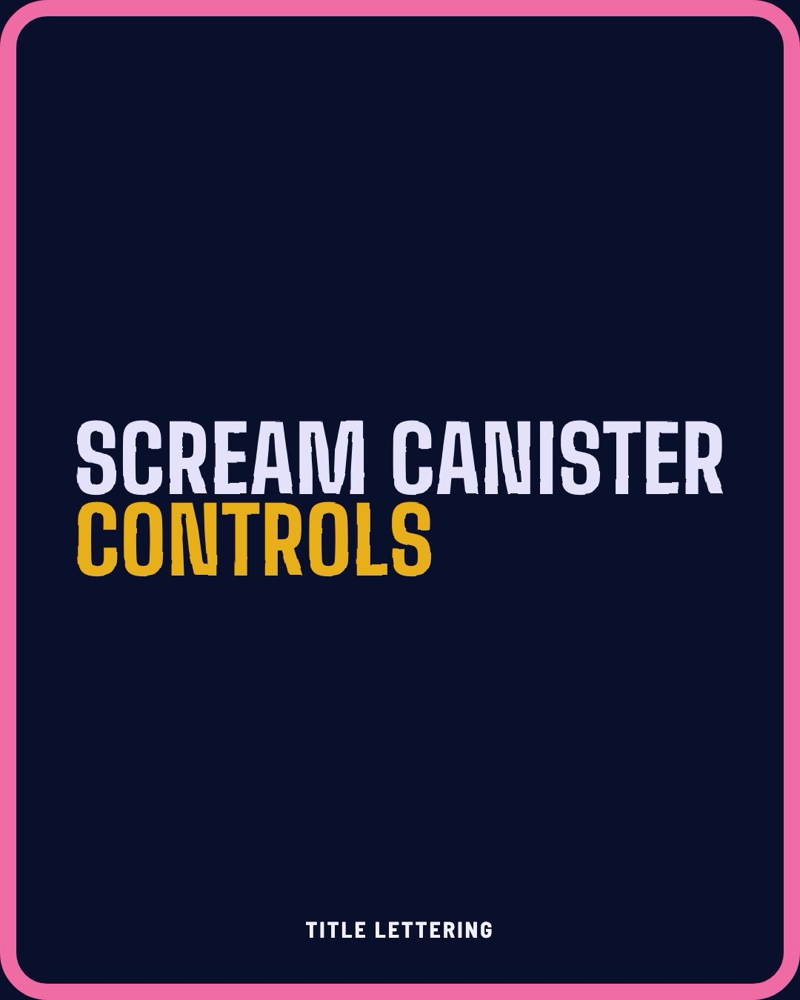

# Scream Canister Controls

[Live demo + design story](https://globalanomalyindex.github.io/scream-canister-controls/) · [Demo video](media/scream-canister-demo.mp4) · [Developer handoff](docs/HANDOFF.md)

I built Scream Canister Controls to see what happens when every button state borrows a mechanic from the scream canisters in *Monsters, Inc.* A scream canister fills, seals, overloads and gets tagged out. Buttons wait, work, finish, fail and get locked. The two line up better than I expected.

## The idea

- **Sight glass** is the progress bar. Seven cells fill in half a second.
- **Check valve** is the busy state. Extra clicks during a fill get ignored, and the cog jams.
- **Overpressure** is an error. The valve blows, a red pen circles the cause, and the same button retries.
- **Lockout tag** is the disabled state. A danger tag says why the button is locked.
- **Hold to seal** is the irreversible confirm.
- **Venting** is undo. The canister drains faster than it filled.

## The motion

Instead of grabbing stock easing curves, I went through the *Monsters, Inc.* and *Monsters University* title sequences frame by frame, tracked 24 moves and fit 12 custom curves to them: press, release, snap, arrive, rise, drop, glide, run, overshoot, overshoot-soft, settle and whip.

Everything is timed in drawings at 24 frames per second, like hand animation. A press is two drawings (83 ms), a release is three (125 ms), and a fill takes the film's half second. The curves in the films turned out to be gentle. The punch comes from the timing, so the buttons copy the timing as well as the curve.

The curves ship as plain CSS. Each one is a `linear()` plateau per drawing, with a `steps()` fallback for older browsers, so there's no animation library.

## The look

The canisters, the loader and the titles are flat cut paper with no outlines, like the *Monsters, Inc.* title cards. The controls themselves are clean pills, which read better as buttons. The canister is drawn from the official Disney Parks prop: a flat top, a wider cap and foot, recessed bands and a seven-cell window. Seven cells of 1,200 SUV add up to the 8,400 SUV on the prop.

Title lettering drops in one letter at a time, and one letter always shows up late. The looping version on the demo page takes your own text.

## Accessibility

- A focus ring on every control, in every browser.
- Disabled buttons stay reachable by keyboard and say why they're locked.
- With reduced motion on, nothing moves, and state still shows through color.
- Loops stop when they scroll off screen.

## What's in this repo

- `index.html`: the live demo and design story. It's a single static page with no build step. Open it locally or serve the folder.
- `docs/HANDOFF.md`: the developer handoff, covering tokens, components, the state matrix, motion timing, the 12 curves and an accessibility checklist.
- `docs/reference/`: the shared kit CSS the demo runs on, the motion tokens and the curve values.
- `media/`: the demo video and the poster frame.

The page loads Big Shoulders, Barlow, Barlow Semi Condensed and Gochi Hand from Google Fonts (SIL Open Font License).

## Credits

A fan-made concept, not affiliated with or endorsed by Disney or Pixar. *Monsters, Inc.* and *Monsters University* are trademarks of Disney. No logos, characters or wordmarks are used, and no film frames are included.

Built with Anthropic's Claude Code with Claude Opus 5.5 and Sonnet 5.5.

Code is MIT licensed. See [LICENSE](LICENSE).
